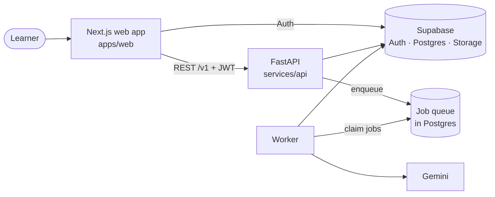

<div align="center">

# 🧭 StudyPilot

**An AI-powered personal learning coach.**

State a goal (a subject, an exam, a certification) or upload your own study material.
StudyPilot builds a personalised roadmap, teaches every topic, quizzes you, finds weak spots,
and adapts what you study next.

[](https://github.com/Rishicreates20/StudyPilotPatch1.2.2/actions/workflows/ci.yml)


[Features](#-features) •
[Quickstart](#-quickstart) •
[Scripts](#-scripts) •
[Architecture](#-architecture) •
[Docs](#-documentation) •
[Security](#-security)

</div>

---

## ✨ Features

| | Feature | What it does |
|---|---|---|
| 🎯 | **Learning goals** | Create goals with a level, target date, daily study minutes, languages (English, Hindi, Odia) and preferences. Pause, complete, archive, restore. |
| 🗺️ | **AI roadmaps** | Gemini drafts a plan of modules, topics, practice and revision. **The server, not the model, checks the schedule** against your daily minutes and target date. Roadmaps are versioned, so earlier plans are never lost. |
| 📚 | **Lessons** | Structured lessons per topic: objectives, sections, worked examples, common mistakes and a summary. Includes *Explain simply*, *Write another version* and resume-where-you-left-off. |
| ✅ | **Quizzes and mastery** | Quizzes generated from each lesson and **graded on the server** (the answer key never reaches the browser). Short answers are marked against a rubric. Per-topic mastery scores highlight weak areas and suggest a next step. |
| 📄 | **Your own material** | Upload PDFs, text files or photos of notes, or paste text. It is read privately, made searchable (semantic + keyword), and lessons then **cite the passages** they were written from. |
| 🃏 | **Flashcards** | Your own cards per goal, scheduled server-side with SM-2 spaced repetition, with a review session and full history. |
| 📤 | **Exports** | Download study notes, a revision sheet or a roadmap as **PDF**, or as **PPTX** slides, with fonts for Latin, Devanagari and Odia. |
| 🔐 | **Accounts** | Supabase Auth with HttpOnly-cookie sessions and PostgreSQL Row Level Security on every table. |

> [!NOTE]
> Set `LLM_PROVIDER=fake` to try the whole flow without an API key. It produces clearly labelled
> sample content for development and tests only.

## 🧰 Tech Stack

| Layer | Technology |
|---|---|
| **Web** | Next.js 16 (App Router), React 19, TypeScript (strict), Tailwind CSS 4, shadcn/ui, `@supabase/ssr` |
| **API** | Python 3.14, FastAPI, Pydantic, psycopg 3, PyJWT, structlog |
| **Data and auth** | Supabase Auth, PostgreSQL with Row Level Security, pgvector, private Supabase Storage |
| **Background jobs** | PostgreSQL-backed durable job queue (`FOR UPDATE SKIP LOCKED`, leases, retries) and a worker process |
| **AI** | Gemini over REST, behind an `LLMProvider` interface (plus a `fake` provider for tests) |
| **API contract** | OpenAPI → generated TypeScript types in `packages/contracts`, checked for drift in CI |
| **Testing** | Vitest + Testing Library, pytest against a real PostgreSQL, Playwright |
| **CI** | GitHub Actions: API, web, real Supabase stack, Docker build, secret scan |

## 🚀 Quickstart

### Prerequisites

- **Git**
- **Node.js 24** with **npm 11** (see `.nvmrc`)
- **[uv](https://docs.astral.sh/uv/)**, which provides Python 3.14
- A **[Supabase](https://supabase.com/) project** (the free tier is fine)
- *(Optional)* a **Gemini API key** from [Google AI Studio](https://aistudio.google.com/app/apikey)

### 1. Clone and install

```bash
git clone https://github.com/Rishicreates20/StudyPilotPatch1.2.2.git
cd StudyPilotPatch1.2.2

npm install                         # web dependencies
uv sync --directory services/api    # API dependencies
```

### 2. Connect Supabase

Follow **[docs/SUPABASE_SETUP.md](docs/SUPABASE_SETUP.md)** to create a project and apply the
migrations:

```bash
npx supabase db push
```

Then create your local env files from the templates and fill in the values:

```bash
cp services/api/.env.example services/api/.env
cp apps/web/.env.example apps/web/.env.local
```

### 3. Run it

Use a separate terminal for each:

```bash
npm run dev:api      # API     → http://localhost:8000  (docs at /docs)
npm run dev:web      # Web app → http://localhost:3000
npm run dev:worker   # Worker: roadmaps, lessons, quizzes, grading, documents, exports
```

Open **<http://localhost:3000>** and sign up. 🎉

### 🐳 Or use Docker

Runs the API and web app with hot reload, against your hosted Supabase project:

```bash
docker compose up --build
```

## ⚙️ Configuration

**API** (`services/api/.env`)

| Variable | Description |
|---|---|
| `DATABASE_URL` | Postgres connection string for your Supabase project |
| `SUPABASE_URL` | Your Supabase project URL |
| `SUPABASE_JWT_MODE` / `SUPABASE_JWT_SECRET` | How the API verifies Supabase access tokens |
| `LLM_PROVIDER` | `gemini` for real AI, or `fake` for labelled sample content |
| `GEMINI_API_KEY` | Required when `LLM_PROVIDER=gemini` |
| `CORS_ALLOWED_ORIGINS` | Origins allowed to call the API (e.g. `http://localhost:3000`) |

**Web** (`apps/web/.env.local`)

| Variable | Description |
|---|---|
| `NEXT_PUBLIC_API_BASE_URL` | Where the API runs (e.g. `http://localhost:8000`) |
| `NEXT_PUBLIC_SUPABASE_URL` | Your Supabase project URL |
| `NEXT_PUBLIC_SUPABASE_PUBLISHABLE_KEY` | Your Supabase publishable (anon) key |
| `NEXT_PUBLIC_APP_NAME` | Display name of the app |

Full details for every variable are in [docs/SUPABASE_SETUP.md](docs/SUPABASE_SETUP.md).

> [!TIP]
> Without the Supabase values the web app still runs, but sign-in shows a *"Sign-in isn't set up
> yet"* notice. The API refuses to start and names the missing variables.

## 📜 Scripts

All scripts run from the repository root.

| Command | What it does |
|---|---|
| `npm run dev:web` | Start the Next.js dev server |
| `npm run dev:api` | Start the FastAPI server with auto-reload |
| `npm run dev:worker` | Start the background job worker |
| `npm run build` | Production build of the web app |
| `npm run lint` | ESLint (web) + ruff (API) |
| `npm run typecheck` | `tsc` (web) + pyright (API) |
| `npm run test` | Vitest (web) + pytest (API) |
| `npm run format` | Prettier + ruff format |
| `npm run check` | Everything above: format check, lint, types and tests |
| `npm run contracts:generate` | Regenerate TypeScript API types from OpenAPI |

> [!NOTE]
> The API tests start a real PostgreSQL. Run `uv sync --directory services/api/tests/pg_server`
> once before `npm run check`.

## 🏗️ Architecture



### Repository layout

```
apps/web             Next.js app (auth, onboarding, dashboard, goals, learn, quizzes,
                     documents, flashcards, exports, settings) + Playwright e2e tests
services/api         FastAPI app, AI layer (app/ai), background worker (app/jobs),
                     documents, retrieval, grading, exports, and tests
packages/contracts   TypeScript types generated from the API's OpenAPI document
supabase/            Database migrations (the schema's source of truth) and templates
docs/                Product and engineering documentation
.github/             CI workflow and helper scripts
docker-compose.yml   Local stack (API + web)
```

### Useful URLs (local)

| URL | Page |
|---|---|
| `localhost:3000` | Landing page |
| `/sign-up` · `/sign-in` | Create an account · sign in |
| `/onboarding` | Three-step setup for new accounts |
| `/dashboard` | Your goals, progress and next steps |
| `/goals/<id>/roadmap` | A goal's roadmap: modules, topics, schedule, versions |
| `/goals/<id>/learn/<topic>` | Lesson workspace for a topic |
| `/goals/<id>/documents` | Your study material for a goal |
| `/goals/<id>/flashcards` | Flashcards and review session |
| `/goals/<id>/exports` | Exported PDFs and slides |
| `/status` | Live web + API health |
| `localhost:8000/docs` | Interactive API docs |

## 📖 Documentation

| Document | What it covers |
|---|---|
| [SUPABASE_SETUP.md](docs/SUPABASE_SETUP.md) | Connecting Supabase: keys, connection string, migrations, env vars |
| [DEVELOPMENT.md](docs/DEVELOPMENT.md) | Installing, running, testing, Docker, troubleshooting |
| [ARCHITECTURE.md](docs/ARCHITECTURE.md) | System design, data model, auth, job queue, AI layer, decisions |
| [PRD.md](docs/PRD.md) | Vision, personas, priorities, requirements |
| [IMPLEMENTATION_PLAN.md](docs/IMPLEMENTATION_PLAN.md) | Milestones, progress and what's next |
| [DESIGN_SYSTEM.md](docs/DESIGN_SYSTEM.md) | Design tokens, components, accessibility rules |
| [CLAUDE.md](CLAUDE.md) | Working agreement for AI-assisted development |

## 🛣️ Roadmap

- [x] Accounts, onboarding and learning goals
- [x] AI roadmaps with server-checked schedules
- [x] Lessons, quizzes, grading and mastery
- [x] Study material upload, search and cited lessons
- [x] Flashcards with SM-2 spaced repetition (first slice)
- [x] PDF and PPTX exports
- [ ] Adaptive revision, reminders, streaks and analytics
- [ ] Multilingual polish and light gamification
- [ ] Release hardening, monitoring and beta
- [ ] Mobile app

See [IMPLEMENTATION_PLAN.md](docs/IMPLEMENTATION_PLAN.md) for the full plan.

## 🔒 Security

- **Never commit secrets.** All `.env*` files are git-ignored; only `.env.example` templates are
  tracked.
- Only `NEXT_PUBLIC_*` values reach the browser.
- The Supabase **service-role / secret key is not used anywhere** and must not be added.
- Every request runs as the authenticated user under Row Level Security, so one user can never
  read another user's data.

More detail in [ARCHITECTURE.md](docs/ARCHITECTURE.md#5-authentication-and-authorization) and
[SUPABASE_SETUP.md](docs/SUPABASE_SETUP.md#7-security-reminders).

## 🤝 Contributing

1. Fork the repo and create a branch: `git checkout -b feature/my-feature`
2. Make your changes and run `npm run check`
3. Commit, push, and open a pull request

Found a bug or have an idea? [Open an issue](https://github.com/Rishicreates20/StudyPilotPatch1.2.2/issues).

## 📄 License

No license has been chosen yet. Until a license file is added, all rights are reserved.

---

<div align="center">

Built by **[Rishikesh Sarangi](https://github.com/Rishicreates20)** · If StudyPilot helps you, please ⭐ the repo!

</div>
